  

  
  
  

---

## About

I'm a B.Tech student in **Automation and Robotics at Vivekanand Education Society's Institute of Technology (VESIT)**, interested in building useful software, connected systems, and thoughtful digital experiences.

My work spans web prototypes, workflow tools, embedded-system concepts, and visual design. I enjoy taking a problem from an early idea through user flows, technical structure, and a practical prototype.

- **Currently exploring:** software development, robotics, embedded systems, and AI-enabled applications.
- **Also interested in:** product thinking, creative technology, debate, and Model United Nations.
- **Experience:** freelance graphic design and school-based training in MUN, debate, and communication skills.

## Selected Work

### Kisan Saathi
*A farmer-focused platform concept*

Designed a prototype around conversational assistance, cold-storage discovery, and collaborative **Create Your Own Pool** logistics.

**Technologies:** React · TypeScript · Python · FastAPI · Google Gemini API · UI/UX prototyping

### POI Chit Portal
*A digital workflow concept for Model United Nations committees*

Developed a web-based concept for managing Points of Information (POIs) and committee scoring, including a framework for evaluating research and articulation and workflow logic for speaking-time cooldowns.

**Technologies:** Google Apps Script · Google Sheets · JavaScript · HTML

### Smart Bi-Directional Room Capacity & Energy Management
*An embedded-system concept for doorway-based occupancy monitoring*

Designed a room-monitoring concept using a finite-state machine to track occupancy through a single doorway. Proposed occupancy-based lighting control, capacity alerts, and sensor debouncing to support more reliable counts.

**Technologies:** ESP32 · C/C++ · VL53L1X Time-of-Flight sensor

> Public repository and demo URLs for these projects were not present in the supplied résumé, so they are intentionally not guessed. Add verified links when the relevant repositories or demos are ready to share.

## Achievements

| Recognition | Verified résumé detail |
|:--|:--|
| Hackathons & ideathons | Finalist — Syrus 7.0 Hackathon |
| Hackathons & ideathons | Finalist — ISTE-VESIT Ideathon |
| Debate | Winner — DJSCE eXpress Invictus 1.0, 2026 |
| Debate | Runner-up — Illusions Debate 2026, VESIT |
| Model United Nations | Participated in 45+ conferences; 17+ awards; 22+ Executive Board roles, as stated in my MUN CV |

## Education & Certifications

**Vivekanand Education Society's Institute of Technology (VESIT), Mumbai**  
B.Tech in Automation and Robotics · September 2025 – May 2029

**Certifications**
- Collaborative Robotics in Industry — L&T EduTech
- Basics of Robotics — Siemens Digital Industries Software
- MATLAB Onramp — MathWorks

## Technical Toolkit

| Category | Technologies |
|:--|:--|
| Programming | Python, C/C++, HTML, CSS, SQL |
| Frameworks & APIs | React, FastAPI, Google Gemini API |
| Tools & workflow | Git, GitHub, Google Antigravity, Google Apps Script, Google Sheets |
| Robotics & embedded systems | ESP32, I²C communication, Time-of-Flight sensors, ultrasonic sensors, MATLAB |
| Design & prototyping | UI/UX prototyping, digital graphics |

## GitHub Activity

The contribution chart below is generated from GitHub contribution data by a third-party chart service. It may be unavailable if that service changes or experiences downtime.

  

I have not added follower, star, language-percentage, or streak cards: those values should only be displayed when a reliable live source can be confirmed.

## Experience

**Freelance Trainer — Tarkus Training (OPC) Private Limited**  
*October 2026 – Present*

Deliver interactive, school-based training sessions for students on Model United Nations, debate, and communication skills.

**Freelance Graphic Designer — Self-employed**  
*January 2021 – July 2026*

Designed social media posts and digital graphics for multiple clients, refining deliverables based on direct client feedback.

## Connect

- [GitHub](https://github.com/swastiktawate)
- [LinkedIn](https://www.linkedin.com/in/swastiktawate)
- [Email](mailto:swastiktawate.work@gmail.com)

  

